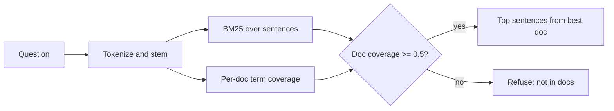

# Solution Design: Docs Q&A Assistant

## Problem
Solstice admins repeatedly ask the same questions that are already in the docs. They want to type a plain-English question and get a grounded answer. If the docs don't cover the question, the system must say so rather than guess.

## Assumptions
- The docs corpus is small (about 6 articles) and changes infrequently. Full re-indexing on startup is fine.
- Questions are in English and short (under 500 characters).
- A wrong answer is worse than no answer, so precision matters more than recall.
- No external LLM or API keys are available in v1. Data stays in-process.

## Development Environment
- Editor: Visual Studio Code v1.142 (Python and Claude Code extensions). Eclipse IDE, Chrome, and LibreOffice are also available.
- Java: OpenJDK 25. Build tool: Apache Maven v3.10.0 (`backend/pom.xml`, Spring Boot 3.5.7).
- Node.js v24.22.0 with Angular CLI v22.2.3. React.js and .NET SDK 10 are also available but not used.
- Frontend: Angular 22 (CLI v22.2.3) on Node 24. The shell files (`package.json`, `angular.json`, `tsconfig.json`, `src/main.ts`, `src/index.html`) are in the repo.
- Not yet verified: no build has been run with these versions. Spring Boot 3.5.7 and TypeScript ~5.9 are chosen to match JDK 25 and Angular 22 but need a confirming build.

## Approach
1. **Passage split.** Each doc is split into sentences. Sentences are the retrieval unit, so the answer is short and specific.
2. **Tokenize.** Apply a curated synonym map (`synonyms.json`, for example "log in" to "login"), lowercase, drop stopwords and question words ("how", "long", "many"), and apply light stemming (-ed, -s).
3. **Rank.** Okapi BM25 scores each sentence against the question terms.
4. **Coverage gate.** For each doc, compute the share of question terms found in its title and body. Only docs with coverage of at least 0.5 are eligible. This is the key refusal mechanism. A single rare term such as "Solstice" in an unrelated doc does not pass.
5. **Answer.** Return the top-ranked sentence from the best eligible doc, plus adjacent sentences that share a query term, along with the doc title and ID. `GET /api/docs/{docId}` serves the full article for the "Show full article" toggle.
6. **Refuse.** If no doc passes the gate, return "I don't have an answer for that in the Solstice documentation."

## Why not an LLM in v1
- Grounding is guaranteed. The answer is an actual sentence from the docs.
- It runs offline, costs nothing, and is deterministic, which makes it testable.
- The retrieval layer is the same one an LLM would sit on top of, so adding one later is a clean extension.

## Trade-offs considered
| Option | Pros | Cons |
|---|---|---|
| Keyword overlap (starter kit Jaccard) | Simple | Penalizes long passages, weak ranking |
| **BM25 + coverage gate (chosen)** | Good ranking, explicit refusal rule, no dependencies | Lexical only; misses synonyms |
| Embeddings + vector DB | Handles synonyms | Infra, model cost, harder to explain refusals |
| LLM answer generation (RAG) | Fluent answers | Hallucination risk, cost, latency, needs eval harness |

## Architecture
- **Backend:** Spring Boot 3.5 (Java 25). `POST /api/ask` returns `{answered, answer, sourceDocId, sourceTitle, confidence}`. `GET /api/docs/{docId}` returns a full article. `POST /api/feedback` appends a rating to `data/feedback.jsonl`. The index is built once at startup.
- **Frontend:** Angular (standalone components). A single page with a question box, example chips, an answer panel that is visually distinct when the system refuses, Helpful / Not helpful buttons, and a full-article toggle.
- **Dev wiring:** The Angular dev server proxies `/api` to port 8080, so no CORS configuration is needed.

## Evaluation
- Unit tests in `DocsQaServiceTest` run the five example questions. Q-1 through Q-4 must return the expected doc. Q-5 must be refused.
- `mvn test -Peval` runs 30 labeled questions (`eval_questions.json`): 22 answerable and 8 out of scope. It reports the correct-doc rate, the refusal rate, and each miss or wrong answer. The eval tests are excluded from the normal `mvn test`.
- Thresholds (`MIN_COVERAGE = 0.5`) were set by hand. Hand-tracing predicts misses on out-of-scope questions that share one generic term with a doc (for example, "price" with the API doc, or "account" with the deletion doc). These are the first things to tune, and the eval run is the evidence for doing so.
- Nothing has been compiled or executed yet. Results must be recorded from a real run.

## With more time, data, or budget
- Grow the eval set to 50+ questions, using real questions from the feedback log.
- Replace the single-term coverage gate with a stricter rule, such as requiring two matched terms for short queries.
- Synonym handling beyond the curated map, via embeddings.
- Hybrid retrieval: BM25 plus embeddings, with the coverage gate kept as a safety check.
- Optional LLM summarizer that is constrained to the retrieved sentences and cites them, with a fallback to extractive output.
- Doc-change ingestion (webhook or nightly job). Feedback is stored but not yet reviewed in a dashboard.
- Telemetry on refused questions to find documentation gaps for the support team.
